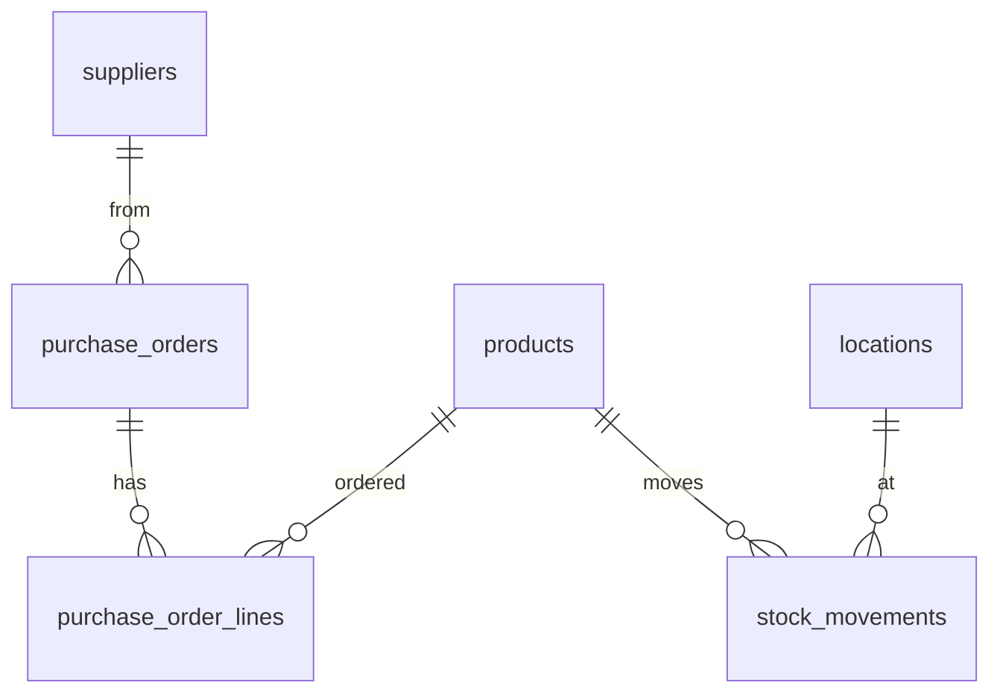

# Data model

Tracebook ERP tracks every item from purchase to sale. This page describes the database tables, why they look the way they do, and the rules that keep stock numbers trustworthy.

The schema lives in [`server/db/schema.ts`](../server/db/schema.ts). Migrations in `server/db/migrations/` are generated from it with `npm run db:generate` and applied with `npm run db:migrate`. Tables are never created or changed by hand in the Supabase dashboard.

## Conventions

| Rule | Why |
| --- | --- |
| Table and column names are `snake_case` in the database, `camelCase` in TypeScript | Drizzle maps between them (`casing: 'snake_case'`), so SQL never needs quoted identifiers |
| Every table has a `bigint` identity `id` | Simple, fast joins; ids are never reused |
| Money is `numeric(12, 2)` | Floating point (`real`) rounds, e.g. 0.1 + 0.2 = 0.30000000000000004 |
| Timestamps are `timestamptz`, stored in UTC | Branches in different time zones still sort correctly |
| Master data is deactivated (`active = false`), never deleted | Old stock movements, POs and sales must keep pointing at a real row |
| Every table has `created_at` and `updated_at` | Basic audit trail; `updated_at` is set by the app on every update |

## Master data (v1)

These tables change rarely. Everything else refers to them.

### `products`

One row per item you sell, at the level you count it (a "Blue T-shirt, size M" is its own product).

| Column | Type | Notes |
| --- | --- | --- |
| `id` | bigint identity | Primary key |
| `sku` | text, unique, required | Human-readable code printed on labels, e.g. `TS-BLU-M`. Never changes once used |
| `barcode` | text, unique, optional | What the POS scanner reads (EAN/UPC) |
| `name` | text, required | Display name |
| `unit` | text, default `pc` | Unit of measure: `pc`, `box`, `kg` |
| `price` | numeric(12,2) | Selling price |
| `cost` | numeric(12,2) | Default purchase cost; actual cost per delivery lives on PO lines |
| `active` | boolean | Hidden from POS and new POs when false |

### `locations`

Anywhere stock can sit. Warehouses and branches share one table so a transfer is always "from location A to location B".

| Column | Type | Notes |
| --- | --- | --- |
| `id` | bigint identity | Primary key |
| `code` | text, unique, required | Short code, e.g. `WH-MAIN`, `BR-A` |
| `type` | enum `location_type` | `warehouse`, `branch`, `in_transit`, `damaged` |
| `name` | text, required | Display name |
| `address` | text, optional | |
| `active` | boolean | |

`in_transit` and `damaged` are virtual locations. Stock sent but not yet received sits in In Transit; rejected or broken stock moves to Damaged instead of disappearing, so it is still accounted for.

### `suppliers`

Who you buy from.

| Column | Type | Notes |
| --- | --- | --- |
| `id` | bigint identity | Primary key |
| `name` | text, required | |
| `contact` | text, optional | Contact person |
| `phone` | text, optional | |
| `email` | text, optional | Not unique: one person can represent several suppliers |
| `active` | boolean | |

## Coming next

| Ticket | Tables | Purpose |
| --- | --- | --- |
| #4 | `stock_movements` | The append-only stock log. Current stock = sum of movements per product per location |
| #5 | `profiles` | User role (`admin`, `warehouse`, `cashier`) and home location |
| #9 | `purchase_orders`, `purchase_order_lines` | What was ordered from a supplier |
| #10 | `receipts`, `receipt_lines` | What actually arrived, accepted vs. damaged |
| #12 | `transfers`, `transfer_lines` | Stock moved between locations |
| #13 | `sales`, `sale_lines` | POS sales |

Every row in `stock_movements` will point back to the document that caused it (a receipt, transfer or sale). That link is what makes it possible to trace a sold item back to its purchase order and supplier.
